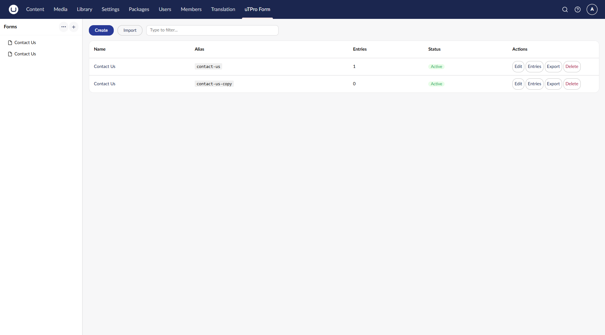
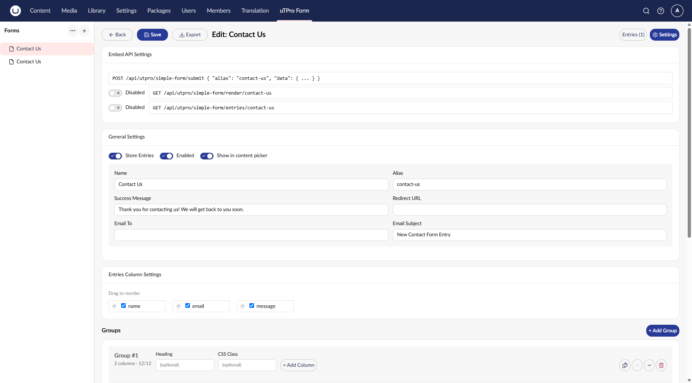
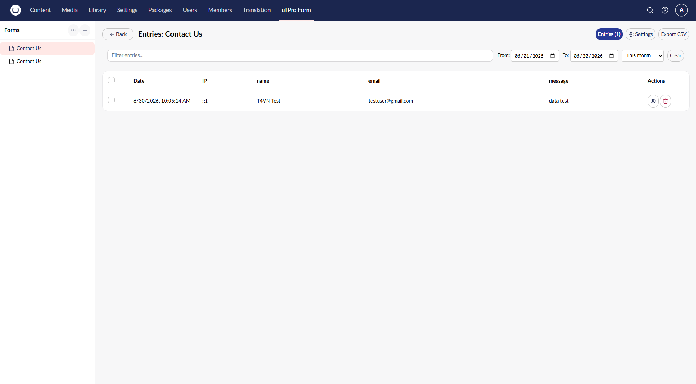

> **Rendered documentation:** [docs.utpro.dev](https://docs.utpro.dev/uTPro.Feature.SimpleFormBuilder/) is the canonical, always-current home of this page.

# Getting Started

[← Back to README](../README.md)

## Install via NuGet

```bash
dotnet add package uTPro.Feature.SimpleFormBuilder
```

Or add as a project reference:

```xml
<ProjectReference Include="path/to/uTPro.Feature.SimpleFormBuilder.csproj" />
```

On first run, uTPro Form automatically creates its database tables and seeds a sample **Contact Us** form. No manual SQL or configuration needed.

## Framework / Umbraco compatibility

| Umbraco | .NET | Package target |
|---|---|---|
| 16 | .NET 9 | `net9.0` |
| 17 & 18 | .NET 10 | `net10.0` |

The package multi-targets both, so the correct dependencies are restored automatically for your project.

## Where It Lives in the Backoffice

After install, a new **uTPro Form** item appears in the top (blue) section menu.

> **Access:** custom sections are governed by user-group permissions. Grant the **uTPro Form** section to a user group under **Users → User groups → _group_ → Sections → Choose → uTPro Form**, then reload the backoffice. See [Security & Permissions](security.md).

The section uses a familiar two-pane layout:



- **Left panel (Forms tree)** — lists all forms. A **+** button creates a new form, and a **⋯ (Options)** menu offers:
  - **Reload** — refresh the list
  - **Create** — new form
  - **Import** — create a form from an exported JSON file

  Each form row also has a **⋯** menu (Edit / Entries / Export / Delete).
- **Main area** — a **Create** button, an **Import** button, a **filter** box, and the forms table (Name, Alias, Fields, Status, Actions). Selecting a form opens it; users without edit rights jump straight to its **Entries**.

## Building your first form

1. Open the **uTPro Form** section
2. Click **Create** (main area) or **+** (left panel)
3. Give it a **Name** and **Alias** (the alias is what you use in code)
4. Add **Groups** to organize fields into sections
5. Inside each group, add **Columns** (12-column grid) and drop **Fields** into them
6. Configure each field: type, label, placeholder, validation, etc.
7. Set the **Success Message**, optional **Redirect URL**, and **Email Notification**
8. Save



Your form is ready to [render on the front-end](rendering.md). Submissions land in the **Entries** view with search, date-range filters, paging and CSV export:



## Copy / Paste (Groups, Columns, Fields)

The builder can copy a whole **group**, **column** or **field** and paste it elsewhere — even into a different form.

- Copy buttons sit on each group/column/field; **Paste** buttons appear only when the clipboard holds a matching item.
- Backed by the browser's **`localStorage`**, so the copied item survives navigating between forms and even a full page reload. Copying a different item type swaps what the Paste buttons offer.
- On paste, all internal IDs are regenerated and colliding field `name`s are de-duped (`_copy`, `_copy2`, …) so submissions never clash.
